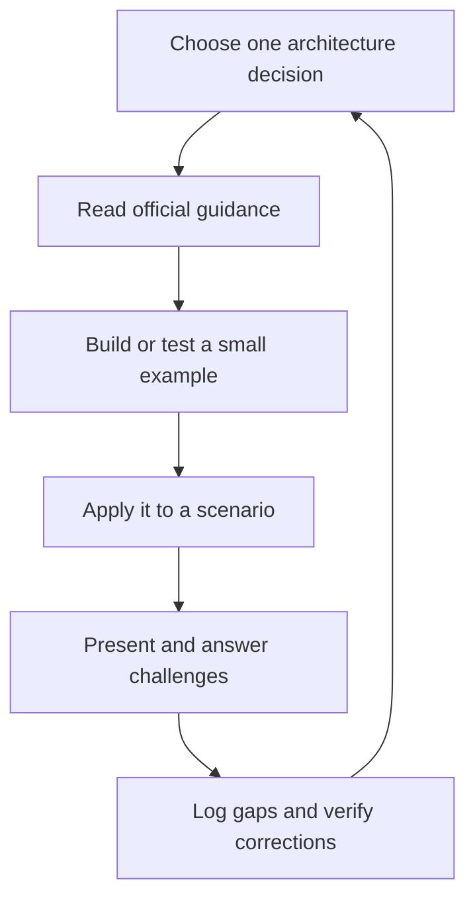

# Realistic Salesforce CTA Study Plan

Prepared: 23 October 2026. Companion: `cta-wiki-audit-2026-10-23.md`.

Updated after retrieving the official Evaluation and Review Board guides. See `cta-guide-comparison-2026-10-23.md` for the SF Toolkit comparison and follow-up evidence. Study-hour estimates remain unofficial planning guidance.

## The Recommendation

For an experienced Salesforce practitioner studying alongside a full-time job, plan **12 focused hours per week for 40 active study weeks**, followed by or interspersed with **8 buffer weeks**. That is about **480 focused hours over 11 months**, allowing for holidays, work peaks, illness, and remediation.

This is a planning estimate, not a Salesforce requirement, pass prediction, or guaranteed route to eligibility. It assumes substantial existing platform and delivery experience. If identity, external sharing, integration, LDV, and deployment are mostly new, extend the schedule rather than cramming.

The wiki is an index, not the entire curriculum. Read official documentation, build small experiments, solve scenarios, present, and respond to live questions. The biggest difference between knowing notes and CTA readiness is making and defending a coherent architecture under time pressure.

## Three Different Goals

| Goal | Focused effort estimate | At 10 hours/week | What it means |
| --- | --- | --- | --- |
| Read the wiki and make a first-pass map | 30-50 hours | 3-5 weeks | Familiarity only, including identifying placeholders/errors. Not mastery. |
| Learn, correct, and apply the main topics | 100-150 hours | 10-15 weeks | Official-source notes plus small labs/mini-cases; not necessarily board-ready. |
| Experienced-architect board preparation | 400-600 hours | 40-60 active weeks | Integrated scenario solutioning, presentation/Q&A, remediation, and mock feedback. Add calendar buffer. |

These are alternative levels of depth, not three effort estimates that must be added together.

## If You Only Want to Learn the Material

Use this **12-week, 10-hour/week route** (120 hours), rather than the longer board-preparation program. It provides a corrected first working understanding, not exhaustive mastery.

| Weeks | Focus | Deliverable |
| --- | --- | --- |
| 1-2 | Source validation, architecture basics, org strategy, licensing, Sales/Service models | Corrected notes, two ERDs, persona/license matrix. |
| 3-4 | CRUD/FLS, sharing, Experience Cloud, IAM, encryption | Access matrix and correct SAML/OIDC/PKCE explanations. |
| 5-6 | Integration patterns, APIs, events, middleware, credentials | Integration decision matrix and failure/recovery design. |
| 7-8 | LDV, limits, storage, migration, reporting, currency | Growth calculation, query-plan exercise, migration/reconciliation plan. |
| 9-10 | Governance, environments, backup, privacy, mobile, adjacent products | Release/restore plans and product-boundary decision cards. |
| 11-12 | Two integrated mini/medium cases, presentation, and gap remediation | Explain and defend an end-to-end solution without relying on the notes. |

Within each 10-hour week, use approximately 4 hours of official-source study, 3 hours of lab/decision work, and 3 hours of case practice/recall. Prioritize core design decisions over memorizing every vendor or UI setting. Continue beyond week 12 where your practical tests reveal weak areas.

## Adjust for Your Starting Point

| Starting point | Initial planning range | Critical assumption |
| --- | --- | --- |
| Experienced cross-domain architect with foundational credentials/knowledge and successful project delivery | 400-600 hours; approximately 9-14 months at 12 hours/week including 15-20% calendar buffer | Most time is practice and closing targeted gaps. |
| Strong developer/admin/consultant with narrower cross-domain architecture exposure | 700-1,000 hours; approximately 16-23 months at 12 hours/week including buffer | Includes substantial foundational learning and hands-on design work; eligibility work may add time. |
| New to Salesforce or to enterprise delivery | Multi-year development path; reassess after foundation and delivery milestones | A short notes-based CTA schedule would be misleading. Real implementation experience matters. |

Use the first two weeks to replace these generic assumptions with evidence about your own gaps. Certifications alone do not establish design readiness, and years of experience alone do not establish breadth.

## Week 1: Confirm the Target

1. Review the official [Evaluation guide](https://help.salesforce.com/s/articleView?id=005299002&type=1) and [Review Board guide](https://help.salesforce.com/s/articleView?id=005298996&type=1&language=en_US). The Evaluation requires Application Architect and System Architect certifications; the Review Board requires a passed Architect Review Board Evaluation.
2. Recheck candidate instructions before booking. The retrieved Review Board timings are 180/45/40 minutes; Evaluation timings are 60/30/30 plus 15 minutes feedback. Both use provided digital materials; the Evaluation explicitly prohibits AI/templates, and the Review Board prohibits Lucidchart templates and materials outside its list. Fees, retakes, evaluation-pass validity, breaks, and day-of logistics remain unverified.
3. Record your credentials, recent architecture responsibilities, strongest domains, weak domains, available study hours, and desired exam window.
4. Attempt one unfamiliar mini-scenario without reading a solution. Draw a model, choose licenses, outline sharing and integration, then explain it for 10 minutes.
5. Find a small study group or knowledgeable reviewer. CTA coach feedback is helpful, but paid coaching is not an official requirement or a guarantee.

Score each topic from 0 to 3: 0 = unfamiliar; 1 = can explain; 2 = can implement/design; 3 = can defend tradeoffs and failure cases. Use the same rubric again at weeks 8, 20, 32, and 40.

## Forty-Week Curriculum

| Weeks | Hours | Focus and guide chapters | Required output / checkpoint |
| --- | ---: | --- | --- |
| 1-2 | 24 | Exam validation, baseline, official resources, initial diagram/communication practice. Wiki 00, 01, 17, 18 plus the audit. | Gap matrix, source-backed correction log, first mini-case, repeatable presentation structure. |
| 3-8 | 72 | Sales/Service data models, licenses, org strategy, standard features, Knowledge, entitlements, Work Orders. Wiki 02, 03, 11-14, 21, 23-25, 27, 30. | Three closed-book ERDs, persona/license matrix, basic Case routing and entitlement experiment. Approximately one mini-case every two weeks. |
| 9-14 | 72 | Security, identity, Experience Cloud, encryption, sessions, network trust. Wiki 05, 06, 09, 22, 26, 28, 29, 31. | Access matrix with positive and negative tests; draw SAML and Code+PKCE; explain token lifecycle. Two or three medium-case presentations. |
| 15-20 | 72 | Integration/API selection, middleware justification, events/CDC, credentials, external data, reporting. Wiki 08, 10, 15, 32, 34. | Integration catalog with volume, latency, identity, retry, idempotency, monitoring, and recovery. Begin full mock every other week. |
| 21-26 | 72 | LDV, migration/cutover, storage, currency, mobile, governance, environments, DevOps, privacy, backup/recovery. Wiki 04, 07, 16, 20, 24, 35, 36 plus official delivery guidance. | Storage/growth math, query/selectivity experiment, offline decision matrix, migration/reconciliation, RPO/RTO restore plan, release/rollback pipeline. Continue fortnightly full mocks. |
| 27-32 | 72 | Integrated architecture and weak-domain remediation. Adjacent products/packages/payments: wiki 13, 14, 19, 33 as relevant, not exhaustive vendor memorization. | End-to-end solutions; approximately one full mock/week when reviewers are available; judge another person's mock. |
| 33-40 | 96 | Board simulation, live Q&A, time management, consistency, and difficult tradeoffs. | Weekly unfamiliar or substantively varied mock, feedback/remediation loop, and final readiness evidence. No last-minute expansion into unrelated products. |
| Buffer | Calendar reserve | Eight non-compulsory calendar weeks spread across the plan or used for remediation. | Preserve rest and work commitments. Do not count missed study hours as completed effort. |

Communication, security, requirements traceability, operational reliability, and lifecycle decisions are practiced throughout. Their dedicated blocks are deep dives, not instructions to omit them from earlier cases. Governance is not an easy afterthought.

**Learning loop**

## A Sustainable Twelve-Hour Week

### Foundation or Mini-Case Weeks

| Block | Duration | Work |
| --- | ---: | --- |
| Four weekday sessions | 75 minutes each = 5 hours | Two documentation/recall sessions, one lab, one decision/presentation drill. |
| Saturday | 5 hours | Scenario work, diagrams, presentation, and review. |
| Sunday | 2 hours | Close the largest gap, update notes, spaced retrieval, and next-week planning. |
| One weekday | No study | Deliberate rest. |

### Full-Mock Weeks

| Block | Duration | Work |
| --- | ---: | --- |
| Four weekday sessions | 1 hour each = 4 hours | Targeted research, small lab, recall, and previous feedback. |
| Saturday | About 6 hours | Working rehearsal: 180-minute solution, 45-minute presentation, 40-minute Q&A, short breaks, and feedback. |
| Sunday | 2 hours | Validate disputed claims, rework the weakest domain, and update the gap log. |

The 180/45/40 allocation is now independently confirmed by the official Review Board guide. It totals 4 hours 25 minutes before breaks, administration, and practice feedback. Before an Evaluation, also rehearse its separate 60/30/30 format plus feedback. Use only permitted blank materials for exam-like simulations; do not rely on prepared Lucidchart templates or AI assistance. Recheck current candidate instructions before booking.

When a full mock exceeds the available time, reduce that week's reading. Do not schedule a 6-hour simulation plus 3 hours of feedback and pretend it fits a 5-hour block. Rotating presenter/reviewer roles requires coordination; preparation and judging both count toward study time.

## How to Study a Chapter

1. Read the chapter once to identify decisions, not to copy every sentence.
2. Check this audit and validate limits/licensing/security claims against current primary documentation.
3. Write a one-page decision card: use case, recommended option, alternatives, tradeoffs, limitations, security, failure/recovery, and dated sources.
4. Build the smallest experiment that answers a real uncertainty. For example: user A cannot read a record; duplicate event processing changes no business result; a query plan explains poor selectivity.
5. Solve a requirement using the option and defend a rejected alternative aloud.
6. Revisit the decision after roughly 1 day, 1 week, and 1 month using closed-book recall.

Aim across the complete plan for roughly 30% reading/source validation, 25% labs/decision work, and 45% scenario/presentation/Q&A. Shift further toward practice late in the plan. These percentages are planning guidance, not a required curriculum.

## Practical Labs Worth Doing

- Compare internal, role-based external, and high-volume external sharing using actual persona access tests.
- Implement a least-privilege integration with modern credentials/principal permissions; verify unauthorized calls fail.
- Explain and, where feasible, configure SSO and client authorization without confusing ID/access tokens.
- Build a bulk-safe automation and compare synchronous/Queueable/Batch constraints.
- Process duplicate events idempotently and design recovery outside the retention window.
- Inspect query plans and demonstrate locking/skew issues with an appropriate safe dataset.
- Import parent/child data through external IDs, reconcile results, and rehearse a cutover/rollback sequence.
- Validate a backup/restore approach, including record relationships/files and agreed RPO/RTO.
- Design a release pipeline with test gates, masked test data, deployment order, and rollback limitations.

Do not purchase unnecessary product licenses solely to complete a lab. Some features need licensed test access; use official documentation and reviewed design exercises when execution is unavailable, and label that boundary honestly.

## Scenario Practice

The retrieved repository contains 6 mini, 3 medium, and 7 full scenario PDFs under [CTA_Practice_Mock_Scenarios](https://github.com/Coding-With-The-Force/Salesforce-CTA-Study-Guide/tree/main/CTA_Practice_Mock_Scenarios).

- Start with mini cases by week 4, medium cases by week 9, and full cases by week 15; do not wait until you have read everything.
- The cadence above allows approximately 20 full presenter sessions. Target roughly 16-20 with reviewed feedback, allowing missed sessions; judge other sessions when available. This is a planning heuristic, not a passing threshold.
- Do not repeatedly memorize the same seven published full scenarios. Have reviewers vary volumes, access requirements, outages, migration windows, and product constraints, or use additional legitimately public material.
- Keep at least one case unseen until a readiness assessment. Repeated performance on a familiar case is weak evidence of transfer.
- Use only legitimate public practice materials, never exam dumps or confidential recalled scenarios. The repository describes its scenarios as public; this review did not independently verify every distribution right.

For every major integration, expect to answer: What fails? Where is a retry safe? How are duplicates prevented? What happens after the replay window? Who gets alerted? How is the business reconciled?

For every major access decision, expect to answer: Which license allows this? What grants object/field access? What grants record access? What specifically prevents the wrong person from seeing it?

## Readiness Gates

Time spent and completed reading are not the release criteria. Before booking or advancing to the applicable stage:

1. Eligibility, exam stage, current rules/tools, timing, fees, and accommodations are confirmed from Salesforce.
2. At least three consecutive unfamiliar or meaningfully varied timed mocks have no unresolved critical security, data-model, or integration flaw in reviewer feedback.
3. Every scenario requirement is mapped to a coherent solution or an explicitly explained constraint/assumption. No requirement is silently dropped.
4. Solutioning and presentation fit confirmed timing; diagrams agree with the license, sharing, and integration decisions.
5. You can defend alternatives and respond to changed requirements without guessing unsupported limits or making the architecture inconsistent.
6. You can explain migration, reconciliation, cutover, deployment, monitoring, backup/restore, and operational ownership, not just functional features.
7. A qualified peer or CTA reviewer has assessed the whole solution, ideally with more than one reviewer perspective.

These are coaching heuristics, not Salesforce's official scoring rubric. If a gate fails, use the buffer to fix the domain; do not book solely because week 40 arrived.

## Scheduling at Other Weekly Capacities

For the same 480-hour baseline:

| Sustainable weekly time | Active weeks | With 20% calendar buffer | Approximate elapsed time |
| --- | ---: | ---: | --- |
| 8 hours | 60 | 72 | 16-17 months |
| 10 hours | 48 | 58 | 13-14 months |
| 12 hours | 40 | 48 | About 11 months |
| 15 hours | 32 | 39 | About 9 months |

Additional weekly hours do not completely eliminate the need for spaced practice, reviewer availability, and implementation experience. Sustaining 20+ hours alongside full-time work can be unrealistic; do not build the plan around your best week.

## Resource Stack

- [Official Evaluation guide](https://help.salesforce.com/s/articleView?id=005299002&type=1) and [Review Board guide](https://help.salesforce.com/s/articleView?id=005298996&type=1&language=en_US): now retrieved through browser title searches; use for policy, scope, prerequisites, timing, and materials. Recheck before committing to a date.
- [Salesforce's June 2026 CTA resource guide](https://www.salesforce.com/blog/architecture-resources-for-cta/): accessible current starting point, including in-scope/adjacent model guidance and communication.
- [Architecture Center](https://architect.salesforce.com/): fundamentals, integration/sharing architecture, decision guides for automation/async/data integration, and Well-Architected.
- [Official Data Model Gallery](https://developer.salesforce.com/docs/platform/data-models/guide/get-started.html): reconstruct and apply relevant standard models.
- Release-current Object Reference, Security Implementation Guide, Apex limits, Mobile Offline, Pub/Sub, and Named Credentials documentation: implementation evidence.
- [SF Toolkit](https://sf-toolkit.com/cta): selective quick-reference supplement, used with the new comparison report; correct its JWT, CDC, sharing-limit, and historical-product guidance before relying on it.
- The GitHub community guide and public scenario collection: secondary explanations, editable notes workspace, and rehearsal material, used with the audit. Neither community guide replaces the official source stack or reviewed scenario practice.

## Information Needed to Personalize This Plan

Your Salesforce delivery/architecture experience, current certifications, actual weekly hours, weakest two domains, access to reviewers, and any target date would determine whether the 40-week baseline should shrink, expand, or start with foundational credentials instead.

If the objective is simply learning the wiki rather than pursuing CTA, use a 10-15-week corrected-topic plan and a few mini/medium cases. Do not commit to an 11-month board program unnecessarily.
